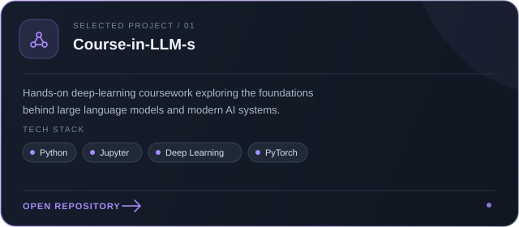
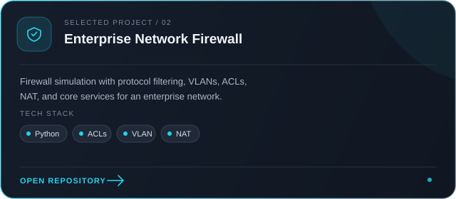
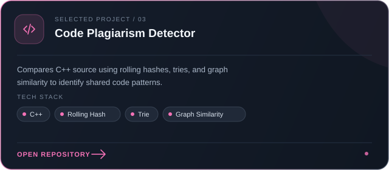
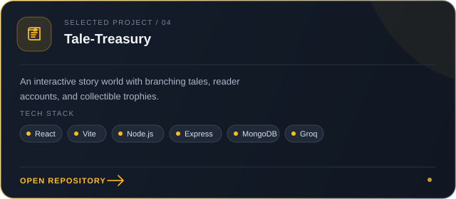
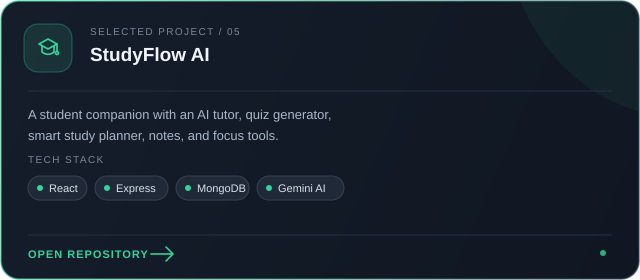
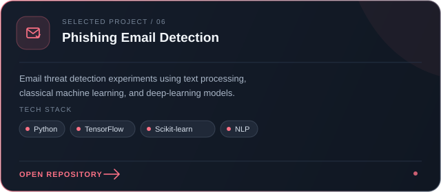
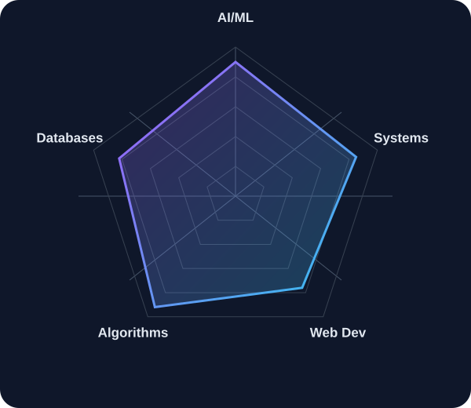
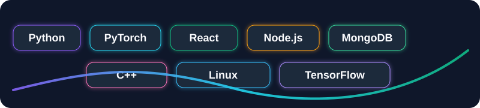
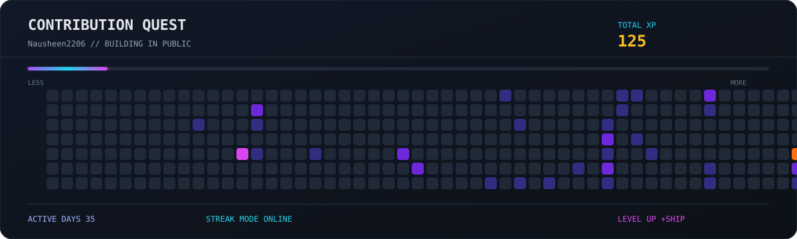

  

  

  <table>
    <tr>
      <td width="33%" style="padding: 12px; background: rgba(168,85,247,0.10); border: 1px solid rgba(168,85,247,0.35); border-radius: 12px;">
        <strong>⚙️ AI Systems</strong>
      </td>
      <td width="33%" style="padding: 12px; background: rgba(34,211,238,0.10); border: 1px solid rgba(34,211,238,0.35); border-radius: 12px;">
        <strong>🧠 Problem Solving</strong>
      </td>
      <td width="33%" style="padding: 12px; background: rgba(16,185,129,0.10); border: 1px solid rgba(16,185,129,0.35); border-radius: 12px;">
        <strong>🚀 Product Thinking</strong>
      </td>
    </tr>
  </table>

---

  
  
  
  

---

## **🎯 About Me**

  <table style="width: 100%; border-collapse: separate; border-spacing: 0;">
    <tr>
      <td width="100%" valign="top" style="padding: 24px; background: linear-gradient(135deg, rgba(168,85,247,0.12), rgba(34,211,238,0.08)); border: 1px solid rgba(148,163,184,0.35); border-radius: 18px; box-shadow: 0 0 0 1px rgba(255,255,255,0.04), 0 10px 30px rgba(168,85,247,0.12); transition: transform 0.2s ease, box-shadow 0.2s ease;">
        
<b>AI + Systems + Product</b>

        
I build production-ready systems that solve real problems. My work sits at the intersection of <b>AI/ML</b>, <b>backend architecture</b>, and <b>web development</b>.

        
I’m a CS student focused on building practical AI tools, scalable systems, and polished product experiences that turn ideas into working software.

        

          
          
          
          
        

      </td>
    </tr>
    <tr>
      <td style="padding-top: 8px;">
        

      </td>
    </tr>
  </table>

---

## Featured Projects

<table>
  <tr>
    <td width="50%">
      
    </td>
    <td width="50%">
      
    </td>
  </tr>
  <tr>
    <td width="50%">
      
    </td>
    <td width="50%">
      
    </td>
  </tr>
  <tr>
    <td width="50%">
      
    </td>
    <td width="50%">
      
    </td>
  </tr>
</table>

---

## **📊 Skills & Tech Stack**

  

### **Frameworks & Tools**

  

### **Core Strengths**

  <table>
    <tr>
      <td width="33%" style="padding: 12px; background: rgba(168,85,247,0.10); border: 1px solid rgba(168,85,247,0.35); border-radius: 12px;">
        <strong>🤖 AI & LLMs</strong>
      </td>
      <td width="33%" style="padding: 12px; background: rgba(34,211,238,0.10); border: 1px solid rgba(34,211,238,0.35); border-radius: 12px;">
        <strong>🧠 Systems</strong>
      </td>
      <td width="33%" style="padding: 12px; background: rgba(16,185,129,0.10); border: 1px solid rgba(16,185,129,0.35); border-radius: 12px;">
        <strong>🌐 Web</strong>
      </td>
    </tr>
    <tr>
      <td width="33%" style="padding: 12px; background: rgba(56,189,248,0.08); border: 1px solid rgba(56,189,248,0.30); border-radius: 12px;">
        <strong>📚 DSA</strong>
      </td>
      <td width="33%" style="padding: 12px; background: rgba(251,191,36,0.08); border: 1px solid rgba(251,191,36,0.30); border-radius: 12px;">
        <strong>🖥️ OS</strong>
      </td>
      <td width="33%" style="padding: 12px; background: rgba(244,114,182,0.08); border: 1px solid rgba(244,114,182,0.30); border-radius: 12px;">
        <strong>📡 Networks</strong>
      </td>
    </tr>
  </table>

---

## **🎮 Contribution Quest**

  

  

